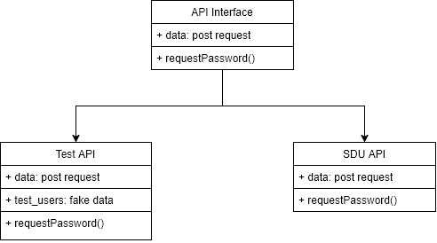

# SDU Booking

> A solution for students and staff looking to book rooms in SDU for self-study/club activities/study groups.

## How to run

Open one terminal and run:

`
cd sdu-booking-backend
pip install -r requirements.txt
python manage.py runserver
`

For the next one, BE SURE TO HAVE NODE.JS INSTALLED WITH NPM!!!
And open another terminal and run:

`
cd sdu-booking-webapp
npm install
copy .env.example .env
npm run dev
`

## COMMON BUG:
If you see that backend is not responding, while running, you may have selected some text on the terminal with the backend running.
Press CTRL + C to deselect it and django will continue working.

## Automated tests

CTRL + C on the terminal with the backend running, then run:

`
python manage.py test
`

OR if you want to run tests of front end, stop the terminal with the front end running by CTRL + C and answering 'y', then run:
`
npm test
`

## Diagrams
  
*Class Diagram*

## Meaningful contributions

Abdrakhpan Dinmukhamed - Backend part and rooms request tests
Myrzatayev Nuraly - Login system and backend login tests
Eralp Sengoz - Frontend part
Orynbassar Nurpeiis - Milestone 3 pdf documentation and class Diagram
