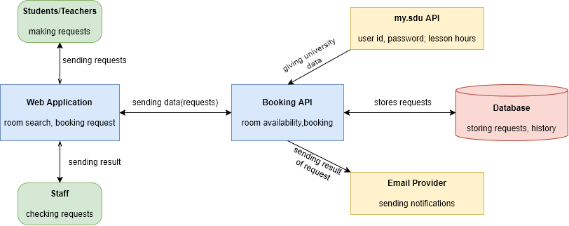
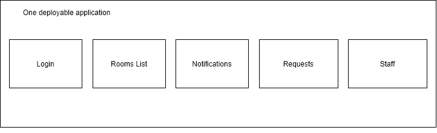

# ARCHITECTURE AND REPOSITORY SETUP

## 1. Container Diagram

## 2. Selected architecture
### Modular Monolith

### **Why it fits:**  
Our application isn’t as complex and more static. And it’s very simple to deploy and make tests on our application because of our architecture’s simplicity.

### **How it supports two important qualities:**
### - Reliability:  
Our system doesn’t have as many dependencies. Simplicity doesn’t let the system fail often.  
### - Performance:
The system has only one external dependency. Many dependencies make it wait for a response.
### Considered alternative:
Layered architecture.  
### The main reason we didn’t select the considered alternative:
Our architecture’s modules don’t have rigid order. Order would mean less efficient design.
## 3. ADR 1
**Status:** Approved

**Context:** We need users to log in and save the identity of the requesting user.

**Decision:** We ask SDU API if the user trying to log in exists with a given login and password. We don’t save the user in the database, only login in requests.

**Alternatives:** We could save the users in the database, specifically their logins and passwords. But it could lead to safety issues, since the passwords in our database would match the SDU services password. Anyone who could potentially have the access to ALL logged in users credentials, could use them in malicious ways.

**Consequences:** Our system is more safe, but anyone using the application has to log in every time limit(because of cookies).  
## 4. GitHub repo:
https://github.com/ih8coffee/sdu-booking
## 5. Team Contribution

| Name | Student ID | Role / Main contribution |
|------|-----------|--------------------------|
| Myrzatayev Nuraly | 240107075 | ADR |
| Abdrakhpan Dinmukhamed  | 240107044 | Container Diagram |
| Eralp Aliyar Sengoz | 220107150 | Repository setup, maintenance, and README |
| Orynbassar Nurpeiis | 240110009 | Architecture Diagram |

## AI Use: NONE. We don’t use AI.